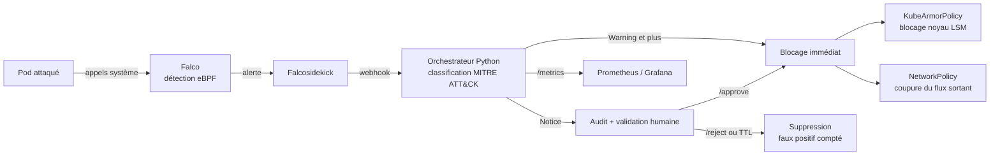

# Orchestrateur adaptatif de sécurité Kubernetes

Détecte une attaque dans un cluster Kubernetes et **applique automatiquement une politique de blocage** ciblée sur le pod attaqué, en quelques fractions de seconde.

Projet issu de mon mémoire de **Master Réseaux et Objets Connectés (CNAM, 2025)**, puis prolongé (v2) pour lever ses limites : blocage réel, attaques rejouables, mesure des faux positifs, validation humaine et métriques.

## Architecture



| Menace | Technique MITRE | Réponse |
|---|---|---|
| Shell dans un conteneur | T1059 | KubeArmorPolicy : blocage des interpréteurs de commandes |
| Lecture de /etc/shadow, clés SSH… | T1003.008 | KubeArmorPolicy : blocage du fichier |
| Connexion vers un serveur C2 | T1071 | NetworkPolicy : coupure du trafic vers l'IP |
| Évasion vers l'hôte | T1611 | KubeArmorPolicy : blocage du binaire |

## Nouveautés de la v2 (par rapport au mémoire)

- **Blocage réel** : passage de Minikube à **k3s** avec AppArmor actif. Dans le mémoire, KubeArmor ne faisait qu'auditer sous Minikube.
- **Politiques ciblées sur le pod** (par ses labels) et non plus sur tout un namespace.
- **Validation humaine** : les alertes de faible priorité créent une politique en *Audit* qui attend une confirmation (`POST /approve`) ou une infirmation (`POST /reject`). Une politique non confirmée **expire** toute seule (TTL).
- **Réponse réseau** : une connexion vers un serveur C2 déclenche une `NetworkPolicy`.
- **Évaluation reproductible** : scénarios d'attaque et d'activité légitime, avec calcul du taux de détection, du taux de faux positifs, du taux de blocage et de la latence.
- **Métriques Prometheus** et **CI** (tests, lint, validation des manifests, ShellCheck, build de l'image).

## Démarrage rapide

Sur une VM Ubuntu (2 vCPU, 4 Go de RAM) :

```bash
git clone https://github.com/HayoubMouffok/k8s-adaptive-security-orchestrator
cd k8s-adaptive-security-orchestrator
sudo ./deploy/install.sh          # k3s + KubeArmor + Falco + orchestrateur + appli de démo
export KUBECONFIG=/etc/rancher/k3s/k3s.yaml
./attacks/run_scenarios.sh        # rejoue les scénarios et produit attacks/results/report.md
```

Le script vérifie d'abord qu'AppArmor ou BPF-LSM est actif : sans eux, KubeArmor ne peut pas bloquer.

## Scénarios d'évaluation

| Id | Nature | Action | Attendu |
|---|---|---|---|
| B1 | légitime | `nginx -t`, lecture du site | aucune alerte |
| M1 | attaque (T1003.008) | `cat /etc/shadow` | blocage immédiat, rejeu refusé |
| M2 | attaque (T1071) | connexion vers le C2 de laboratoire | NetworkPolicy, rejeu coupé |
| B2 | légitime | appel HTTP interne | trafic toujours autorisé |
| M4 | attaque (T1528) | lecture du jeton du compte de service | répertoire du jeton interdit en lecture |
| B3 | légitime | écriture d'un cache dans `/tmp` | toujours autorisée |
| M5 | attaque (T1105) | exécution d'un outil déposé dans `/tmp` | exécution interdite depuis `/tmp`, `/dev/shm`, `/var/tmp` |
| M6 | attaque (T1554) | écriture dans `/usr/bin` | répertoires de binaires en lecture seule |
| M3 | attaque (T1059) | shell dans le conteneur | audit, validation humaine, puis blocage |
| B4 | légitime | service web après toutes les politiques | toujours fonctionnel |

## Supervision (Prometheus + Grafana)

```bash
./deploy/monitoring.sh   # Grafana sur le port 30300 du nœud, tableau de bord chargé automatiquement
```

Le tableau de bord affiche les alertes par type de menace, les politiques appliquées (blocage ou audit), les validations en attente, la latence médiane détection → blocage, les faux positifs et les audits expirés.

## Résultats

### Mémoire (v1, Minikube)

| Indicateur | Valeur |
|---|---|
| Politiques générées | 6 (3 types de menaces) |
| Temps de génération par politique | 680 à 910 ms |
| Chaîne détection → application | ~0,9 s (contre ~50 min estimées en traitement manuel) |
| Limite | application effective non garantie (mode audit sous Minikube) |

### v2 (k3s)

Mesuré le 21/11/2026 sur k3s (VM Ubuntu 24.04, 2 vCPU), Falco modern_ebpf, KubeArmor avec AppArmor, 6 attaques (6 techniques MITRE ATT&CK) et 4 actions légitimes :

| Indicateur | v1 (mémoire) | v2 |
|---|---|---|
| Taux de détection | non mesuré | **100 %** (6/6) |
| Faux positifs | non mesuré | **0 %** (0/4) |
| Attaques rejouées bloquées | non garanti (audit) | **100 %** (6/6) |
| Actions légitimes préservées | non mesuré | **100 %** (3/3) |
| Latence détection → politique appliquée | ~0,9 s | **0,03 s** (médiane, max 0,04 s) |

Rapport détaillé régénéré à chaque exécution dans `attacks/results/report.md`.

**Limite observée** : AppArmor ne contrôle pas le premier binaire lancé par un `kubectl exec` (la transition vers le profil KubeArmor a lieu à cet exec). Un shell lancé directement par `kubectl exec -- sh` n'est donc pas bloqué, contrairement à un shell lancé depuis le conteneur, comme lors d'une RCE. Ce cas se traite par le RBAC (droit `pods/exec`), ce qui complète la réponse automatique.

## API de l'orchestrateur

| Méthode | Route | Rôle |
|---|---|---|
| POST | `/falco` | réception des alertes Falcosidekick |
| POST | `/approve/<ns>/<politique>` | confirmer : Audit → Block |
| POST | `/reject/<ns>/<politique>` | infirmer : suppression, faux positif compté |
| GET | `/events` | historique des alertes traitées |
| GET | `/metrics` | métriques Prometheus |

Configuration par variables d'environnement : `WATCHED_NAMESPACES`, `AUTO_BLOCK_PRIORITIES`, `POLICY_TTL_SECONDS`, `APPROVAL_WEBHOOK_URL` (Slack ou Mattermost), `DRY_RUN`.

## Développement

```bash
pip install -r requirements.txt pytest ruff
pytest -q && ruff check src tests attacks
```

## Structure

```
src/orchestrator/   code de l'orchestrateur (classification, politiques, API, client Kubernetes)
deploy/             installation k3s + KubeArmor + Falco, manifests
attacks/            scénarios d'attaque et calcul des indicateurs
tests/              tests unitaires
docs/memoire/       extraits du code et politiques du mémoire (v1)
```

## Stack

Kubernetes (k3s), KubeArmor, Falco (eBPF), Falcosidekick, Python (Flask, client Kubernetes), Prometheus, GitHub Actions.
